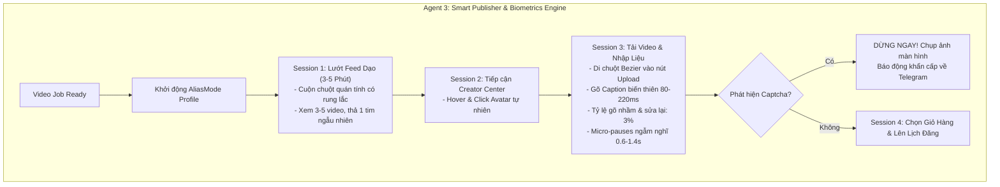

# Autonomous Multi-Agent TikTok Affiliate System (AMAS)
## System Architecture & Technical Specification

> **Version:** 1.4.0  
> **Status:** Production Architecture Approved  
> **Database:** PostgreSQL (with JSONB & SQLAlchemy Async) | **Broker:** Redis  
> **Anti-Detect Engine:** **AliasMode** + **Human Behavioral Biometrics Engine** (`human_behavior.py`)  
> **Target Niches (Pilot):** 1. Thời trang nữ (Women's Fashion) | 2. Đồ gia dụng thông minh (Home Utilities)  
> **Core Framework:** Python 3.11+, LangGraph, Playwright, AliasMode, aiogram (Telegram)

---

## 1. Executive Summary

Hệ thống **AMAS v1.4.0** là giải pháp Multi-Agent khép kín cho vận hành TikTok Affiliate an toàn, bền vững tại Việt Nam. Phiên bản này bổ sung toàn diện **Human Behavioral Biometrics Engine** để triệt tiêu mọi dấu hiệu tự động hóa (Bot patterns), biến Playwright và AliasMode thành một KOC người thật đang thao tác thủ công.

Hệ thống bao gồm 5 Agent chức năng:
1. **Specialist Scout Agents (Agent 1):** `FashionScoutAgent` & `HomeLifeScoutAgent` nghiên cứu thị trường chuyên sâu theo từng ngách.
2. **Video Remix Studio (Agent 2):** Biến đổi video, lồng tiếng tiếng Việt tự nhiên (`edge-tts`), thay thế Persona và lách bản quyền (`FFmpeg`).
3. **Smart Publisher & Human Simulator (Agent 3):** Đăng bài tự động qua AliasMode kết hợp **Mô phỏng sinh trắc học người thật** (lướt dạo feed 3–5 phút, gõ phím ngập ngừng, cuộn trang quán tính, cảnh báo Captcha về Telegram).
4. **Hermes Orchestrator & Analytics Loop (Agent 4):** Điều phối trạng thái qua LangGraph, thu thập số liệu và tự động tối ưu prompt.
5. **Comment Engagement & Conversion Agent (Agent 5):** Quét bình luận của người xem, dùng AI trả lời tư vấn chuẩn Persona và điều hướng chốt đơn giỏ hàng vàng.

---

## 2. Updated System Architecture & Biometrics Pipeline



---

## 3. Quy chuẩn mô phỏng hành vi sinh trắc học (`human_behavior.py`)

Hệ thống áp dụng 5 nguyên tắc sinh trắc học hành vi nghiêm ngặt:

1. **Cuộn trang quán tính (Inertia Human Scrolling):**
   - Không dùng `window.scrollTo()` nhảy cóc.
   - Sử dụng chuột lăn từng nấc (wheel ticks) có gia tốc tăng giảm, thỉnh thoảng có bước cuộn ngược nhẹ ($10\% - 20\%$ quãng đường) mô phỏng người dùng lỡ tay cuộn quá đà.
2. **Mô phỏng gõ phím sinh trắc học (Biometric Typing):**
   - Độ trễ phím dao động ngẫu nhiên: $80\text{ms} - 220\text{ms}$.
   - Tỷ lệ gõ sai (Typo Simulation): $3\%$. Khi gõ sai, bot sẽ dừng lại $300\text{ms}$, bấm phím `Backspace` xóa đi và gõ lại chữ đúng.
   - Điểm dừng ngẫm nghĩ (Micro-pauses): Khi kết thúc 1 câu hoặc trước khi gõ hashtag, bot ngẫu nhiên dừng $0.6\text{s} - 1.4\text{s}$ như người thật đang suy nghĩ.
3. **Quỹ đạo chuột cong Bezier (Non-linear Mouse Curves):**
   - Sử dụng thuật toán đường cong Bezier bậc 3 (`ghost-cursor`), di chuyển có gia tốc đầu chậm - giữa nhanh - cuối chậm, đi kèm độ rung lắc nhẹ ($\pm 2\text{px}$).
   - Luôn hover lên mục tiêu $200\text{ms} - 400\text{ms}$ trước khi bấm chuột (mousedown $\rightarrow$ delay $\rightarrow$ mouseup).
4. **Quy trình "Lướt dạo feed" trước khi đăng (Pre-posting Warm-up):**
   - Không bao giờ nhảy thẳng vào trang `creator-center/upload`.
   - Luôn mở trang chủ `tiktok.com`, lướt xem 3–5 video trong $3 - 5$ phút, xem hết tối thiểu $60\%$ thời lượng mỗi video, ngẫu nhiên thả 1 tim để tạo lịch sử tương tác sạch.
5. **Cơ chế phòng thủ Captcha (Emergency Captcha Guard):**
   - Khi TikTok hiển thị Captcha xoay hình ảnh hoặc thanh trượt: **Bot lập tức DỪNG MỌI THAO TÁC** (không được cố click giải Captcha bằng thuật toán vì rất dễ bị đánh dấu bot vĩnh viễn).
   - Bot tự động chụp ảnh màn hình, gửi về Telegram của Admin kèm chuông báo động:
     > `🚨 [CẢNH BÁO CAPTCHA TIKTOK - KÊNH FASHION 01]`  
     > `Phát hiện màn hình yêu cầu xác minh danh tính. Bot đã tạm dừng an toàn!`  
     > `👉 Vui lòng mở trình duyệt giải bằng tay trong vòng 5 phút.`

---

## 4. Quản lý trạng thái vòng đời kênh (Channel Lifecycle States)

Trong PostgreSQL, mỗi kênh TikTok có trạng thái rõ ràng:
* **`warming` (Đang nuôi nick 3–5 ngày đầu):** Chỉ chạy bot lướt feed, like dạo, xem video theo ngách $5 - 10$ phút/ngày để tích lũy độ trust từ địa chỉ IP dân cư tĩnh. Chưa cho phép đăng bài affiliate.
* **`ready_to_post` (Sẵn sàng đăng):** Đã qua giai đoạn nuôi nick, được phép nhận lịch đăng $1 - 2$ video/ngày.
* **`cooldown` (Giãn cách an toàn):** Trạng thái nghỉ tối thiểu 4–6 tiếng giữa 2 lần đăng bài.
* **`captcha_blocked` (Cần giải cứu):** Đang chờ người dùng can thiệp gỡ xác minh.

---

## 5. PostgreSQL Database Schema (Cập nhật bảng Channels)

```sql
-- Cập nhật bảng quản trị kênh với trạng thái nuôi nick và chỉ số hành vi
CREATE TABLE channels (
    channel_id VARCHAR(50) PRIMARY KEY,
    niche_id VARCHAR(50) REFERENCES niches(niche_id) ON DELETE CASCADE,
    browser_provider VARCHAR(30) DEFAULT 'aliasmode',
    browser_profile_id VARCHAR(100) NOT NULL UNIQUE,
    proxy_url VARCHAR(255),
    lifecycle_status VARCHAR(30) DEFAULT 'warming', -- warming, ready_to_post, cooldown, captcha_blocked
    warmup_days_completed INTEGER DEFAULT 0,
    last_posted_at TIMESTAMP WITH TIME ZONE,
    max_posts_per_day INTEGER DEFAULT 2,
    created_at TIMESTAMP WITH TIME ZONE DEFAULT CURRENT_TIMESTAMP
);
```
